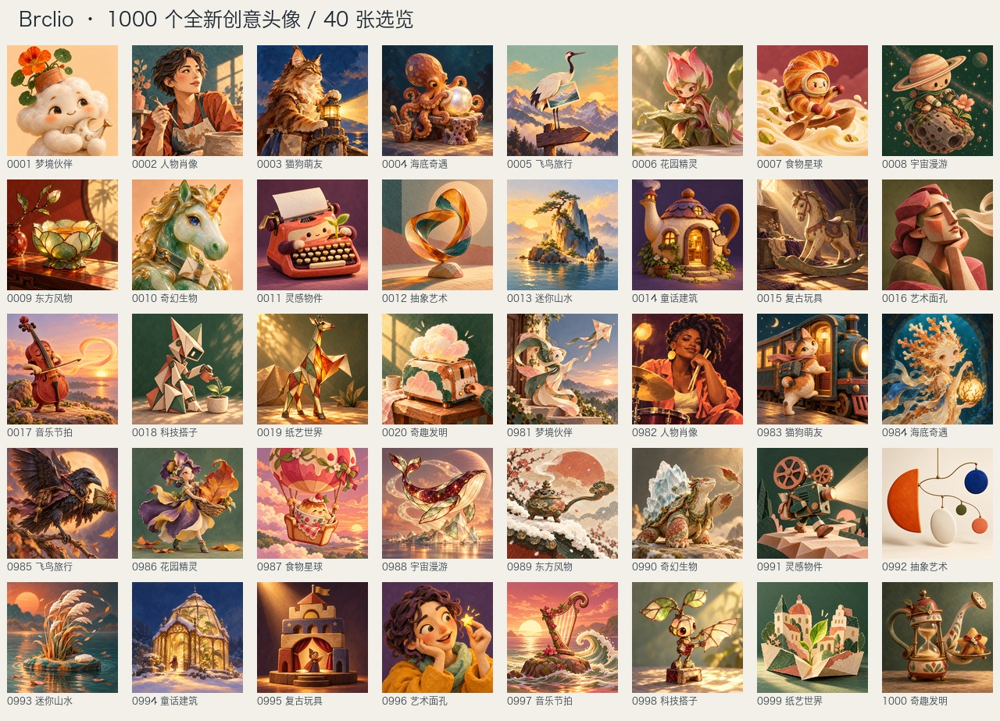

# 内置头像 v2

本次重制要求 1000 张全新、独立构思的头像，全部通过内置 `image_gen` 逐张生成。20 个主题各 50 张，以 `(编号 - 1) % 20` 交错排列；网页与小程序每页仍显示 40 张，每页能看到每个主题的两张作品。每张的具体名称、主题与完整提示词见 `prompts.json`。



1000 张已全部生成、验收并导入，5 张在视觉复查后重新生成。实际内置工具返回的原始文件保存在本地 `artifacts/avatar-redesign/raw/0001.png` 至 `1000.png`，逐次生成记录位于同目录上级的 `generation.json`。每条记录包括工具返回的文件路径、归档路径、生成时间、原图 SHA256 及实际提示词 SHA256；原始文件不做重绘、换色或重新编码。

导入器只做技术性缩小与 PNG 压缩，将完整正方形原图缩为 256×256，不裁成拼图、不改变颜色或设计。它会验证 1000 份独立的生成记录和原始文件、逐张哈希与提示词、输出唯一性以及全部展示图小于 128 MiB 的体积上限。成功导入后，`assets.json` 记录每张图片的名称、主题、生成时间、原图和提示词 SHA256、最终 PNG SHA256、尺寸与字节数。

```sh
# 根据完整提示词更新客户端精简名称表，不改图片。
python3 scripts/generate-builtin-avatars.py --metadata-only

# 全部原图与生成记录齐备后，在 artifacts 内准备 256px 展示图。
python3 scripts/generate-builtin-avatars.py

# 再次验证全套资源，通过后一次性替换 web/avatars；旧目录保留在本地 artifacts 中。
python3 scripts/generate-builtin-avatars.py --apply

node --test tests/avatar-catalog.test.js tests/account-avatar.test.js tests/avatar-native.test.js tests/web-avatar.test.js
```

图片地址仍为 `/avatars/0001.png` 至 `/avatars/1000.png`，客户端和账号接口统一附加 `?v=20261026` 更新缓存。账号保存的 1–1000 编号及用户自定义头像不变。网页构建将 `web/avatars/` 复制到 `dist/web/avatars/`；小程序按需从现有网站域名加载图片，只打包不足 64 KiB 的主题与名称表，不打包图片、原图、完整提示词或生成记录。

生成与导入已完成，1000 张展示图共 119,566,015 字节。网页部署与微信上传分别验收，实际发布阶段见 [发布记录](../../docs/AVATAR_REDESIGN_RELEASE.md)。
